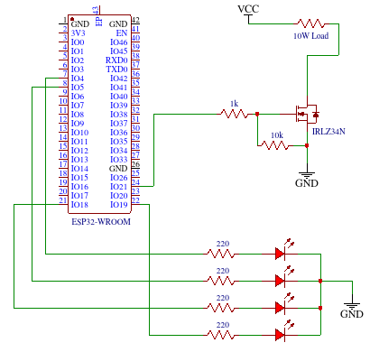
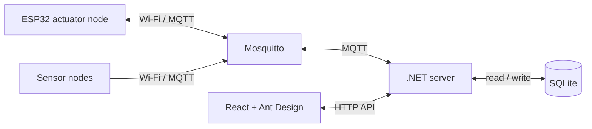

# ESP32 Home Automation


Wi-Fi home automation with ESP32 nodes, a .NET 10 server, MQTT, SQLite, and a
React dashboard built with Ant Design. This repository contains:

- `main/`: ESP32 firmware for five configurable GPIO outputs (4, 5, 18, 19, 21).
- `server/`: .NET 10 API, MQTT connection, automation engine, and SQLite database.
- `web/`: React dashboard built with Ant Design.

Areas group two node types: **sensors** report readings and **actuators** expose
controllable outputs. ESP32 nodes announce themselves through MQTT and appear in
the dashboard automatically. The dashboard can rename nodes, assign them to
areas, switch outputs, create sensor rules, and set daily time windows. SQLite
stores the layout, latest reported state, rules, and schedules; the ESP32
remains the source of truth for output state. Existing databases are upgraded
in place at startup.

## Demo media

### Circuit schematic



The drawing shows four indicator LEDs and one MOSFET-switched load. Add the
dashboard screenshots and on/off and PWM GIFs to `docs/media/` when ready:

| Media | Suggested filename | Shows |
| --- | --- | --- |
| Dashboard screenshot | `dashboard.png` | Areas, nodes, and output controls |
| Automations screenshot | `automations.png` | Sensor rules, schedules, and timers |
| On/off demo | `on-off.gif` | A dashboard switch changing a real output |
| PWM demo | `pwm.gif` | Slider changing output duty cycle |


## Architecture



The included ESP32 firmware implements an actuator node. The server also
supports sensor nodes through MQTT, but sensor firmware is not included here.

## Run the central server

The checked-in configuration is for a quick LAN test: the server connects to
Mosquitto at `127.0.0.1:1883`. If Mosquitto is already listening on port 1883,
keep that instance. Otherwise, run it from this folder with:

```sh
mosquitto -c broker/test-mosquitto.conf -v
```

The broker machine must be reachable from the ESP32, and port 1883 must accept
LAN connections. Copy `main/local_config.example.h` to `main/local_config.h`,
then set `WIFI_SSID`, `WIFI_PASSWORD`, and `MQTT_BROKER_URI` there before
flashing. The local header is ignored by Git. A phone's USB tether and
Wi-Fi hotspot can put the PC and ESP32 on separate networks, so check their
reachability. The broker must allow subscriptions to `devices/+/status`,
`devices/+/led/state`, and `devices/+/sensor/state`, and publishing to
`devices/+/led/cmd`.

To develop the UI, start the API and Vite in separate terminals:

```sh
dotnet run --project server --urls http://127.0.0.1:5050
```

```sh
cd web
npm ci # first run only
npm run dev
```

Open the URL printed by Vite. It proxies `/api` to the .NET server. To serve
the built UI from .NET instead, run:

```sh
cd web && npm run build && cd ..
dotnet run --project server --urls http://0.0.0.0:5050
```

Open `http://<server-ip>:5050` on your LAN. SQLite is created automatically at
`server/home.db`. The API and built UI are served by the same .NET process.

For TLS later, configure a broker listener on port 8883, change `Mqtt:UseTls`
to `true`, `Mqtt:Port` to `8883`, and the firmware URI to
`mqtts://your-broker-name:8883` in `main/local_config.h`. If the broker uses a private CA, put its public PEM
certificate at `main/mqtt_ca_cert.pem` and set `Mqtt:CaCertificatePath` to
`../main/mqtt_ca_cert.pem`. Rebuild and reflash the ESP32 after changing the
firmware URI or CA file. The broker certificate must contain the name used by
the clients.

The dashboard currently has no user login, so keep it on a trusted LAN.

## Sensors and automations

Sensor nodes publish a retained JSON message to
`devices/<device-id>/sensor/state`, for example:

```json
{"sensors":[{"key":"temperature","value":29.5,"unit":"°C"},{"key":"motion","value":true}]}
```

Values can be numbers or booleans (`true` = 1, `false` = 0). A sensor node can
publish `online`/`offline` to `devices/<device-id>/status` like actuator nodes.
The dashboard discovers sensor keys after the first state message.

In **Automations**, a sensor rule compares a reading with a threshold and
sets one actuator output on or off when the condition changes. An optional
"otherwise" action runs when it stops matching. For example, temperature
`> 30` can turn a fan on, then turn it off below the threshold. Rules react to
new readings; they do not poll the sensor.

A time schedule maintains an actuator output **on inside** its configured
window and **off outside** it, checking every 15 seconds. The default timezone
is `Asia/Karachi` in `server/appsettings.json`; set `Automation:TimeZone` to your
desired IANA timezone. The schedule supports selected weekdays and windows
that cross midnight. A countdown timer can turn an output on or off for a
chosen number of minutes, then reverse the action. Pending and running timers
survive server restarts; if the node is offline at the end, the ending command
is sent when it reconnects. Only one active automation can own an output at a
time, to avoid conflicting commands. Pausing a rule or schedule stops its
commands and restores manual control of that output.

To check schedule boundaries, rule comparisons, and the SQLite upgrade path,
run `dotnet run --project tests` from this folder.

## Flash the ESP32

The firmware keeps its Wi-Fi name, password, and broker address hardcoded in
`main/local_config.h`, which stays on your PC and is ignored by Git. Start by
copying `main/local_config.example.h` and setting the three values for your
network. The demo broker uses plain MQTT on port 1883 without a certificate
or MQTT login.

When using TLS, the ESP32 validates the broker certificate against
`main/mqtt_ca_cert.pem` if that file exists, or against ESP-IDF's public CA
bundle otherwise. It synchronizes its clock with `pool.ntp.org` before a TLS
connection because certificate dates must be checked. Set `NTP_SERVER` in
`main/esp32_init.c` to a local NTP server if the Wi-Fi network has no internet
access. Plain MQTT does not wait for clock sync.

With ESP-IDF installed and activated:

```sh
idf.py build
idf.py -p /dev/ttyACM0 flash monitor
```

Replace `/dev/ttyACM0` with the serial port shown on your PC. A successful
startup prints `IOT: IP:` and then `IOT: MQTT connected`.

The device ID is `esp32-` followed by the Wi-Fi MAC address in hex. It publishes
retained state at `devices/<device-id>/led/state` and retained online/offline
status at `devices/<device-id>/status`. The central server subscribes to both.
Commands go to `devices/<device-id>/led/cmd`, for example
`{"led":0,"state":true}`. The UI waits for the device's state report instead of
pretending a command already succeeded.

Each output can be changed between **On/off** and **PWM** in its dashboard card.
PWM uses the ESP32 LEDC peripheral at 5 kHz, with a slider from 0 to 100%.
The output mode and last nonzero PWM level are saved in ESP32 NVS, so a reboot
keeps the configuration while starting the physical output off. The server
stores the most recently reported mode and current level in SQLite. Changing
mode also turns that output off. An on/off automation targeting a PWM output
turns it on at its last nonzero level (100% until a level is chosen), or off
at 0%. Pause an automation to adjust its output mode or level manually.

The device also accepts `{"led":0,"mode":"pwm"}`,
`{"led":0,"level":45}`, and `{"led":0,"mode":"digital"}`. State reports include
`mode` and `level` for each output.

## Hardware and demo

The five GPIO pins are control signals for suitable transistor or driver
circuits. Choose the driver, power supply, and protection components for the
load in your schematic; do not power a load directly from an ESP32 GPIO.

For a short demo, show the ESP32 appearing online in **Nodes**, switch an
output on and off, change that output to PWM mode, and move its 0–100% slider.
The GIFs listed above can show the physical load responding beside the UI.
You can also show a time schedule or a sensor rule if a sensor node is available.

The included Mosquitto configuration is for a trusted local test network: it
allows anonymous connections on port 1883 and does not encrypt MQTT traffic.
The dashboard has no user login. TLS needs a configured broker listener and
matching certificates before enabling it in both clients.
